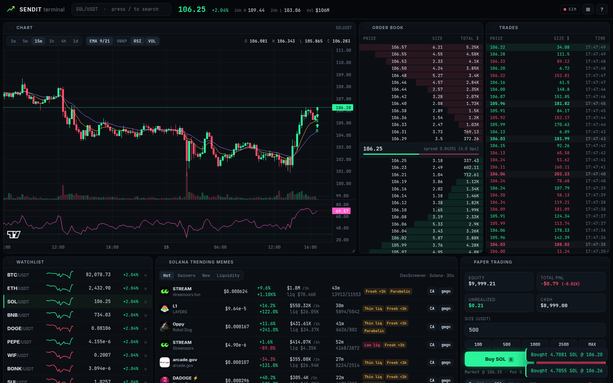
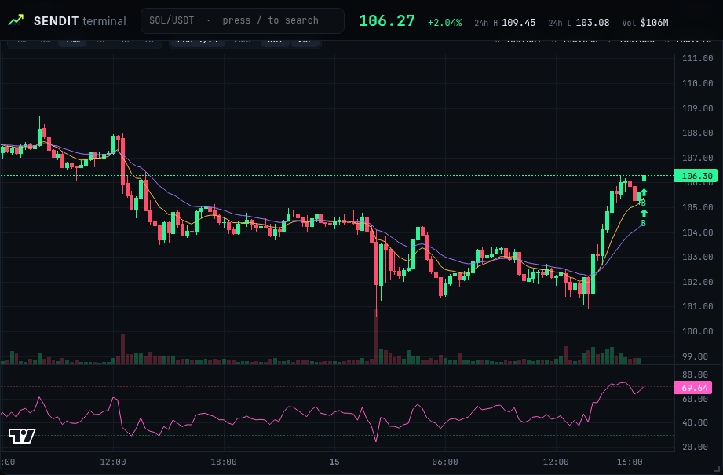
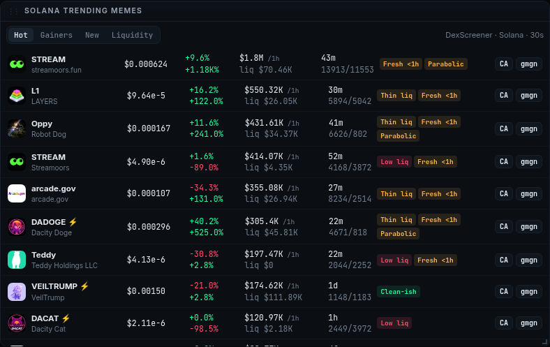
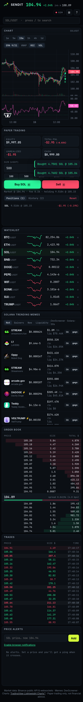

# Sendit Terminal

A pro, degen-native crypto trading terminal in the browser. It has live Binance prices, TradingView candlesticks, order book depth, a trades tape, Solana trending memes with risk flags, price alerts and paper trading. Everything runs client-side with no API keys.

**Live:** https://xdi8blox.github.io/sendit-terminal/






## Features
- **Live Binance feed:** combined websocket streams (kline, miniTicker, aggTrade, depth) with auto-reconnect. If the socket can't connect or a stream goes silent, the app drops to a clearly badged **SIM** mode.
- **Chart:** lightweight-charts candlesticks with 1m–1d timeframes, EMA 9/21, VWAP, RSI pane, volume, and trade markers.
- **Order book depth and live trades tape.**
- **Watchlist with sparklines.**
- **Solana trending memes:** from DexScreener, with risk flags (thin liquidity, fresh pair, parabolic, low liquidity) plus CA copy and gmgn links.
- **Price alerts:** with browser notifications.
- **Paper trading:** $10k start, 0.1% fee, PnL and history, saved in localStorage.
- **Layout:** draggable, resizable panels saved locally.
- **Hotkeys:** `/` search, `1–6` timeframes, `B`/`S` buy/sell, `E`/`V`/`R` indicators, `↑↓` watchlist, `Shift+L` reset layout, `?` help.

## Data sources (keyless)
Binance public REST and WS (with data-api/data-stream.binance.vision fallbacks) and DexScreener public API.

Charts by [TradingView Lightweight Charts](https://www.tradingview.com/lightweight-charts/).

## Dev
```bash
npm i && npm run dev
npm run build
```

## License
MIT
